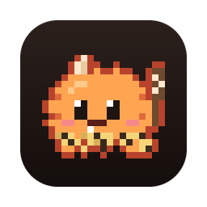
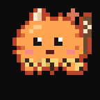
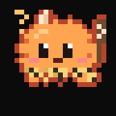

<p align="center"></p>

<h1 align="center">뚝딱 (Ttukttak)</h1>

<p align="center">맥북 노치에 사는 도트 도깨비 <b>복슬깨비</b>가 Claude Code가 지금 뭘 하는지 보여 주는 맥 앱</p>

<p align="center"><a href="#english">English</a></p>

---

## 무엇을 하나요

- Claude Code가 생각하고, 작업하고, 질문하고, 허락을 기다리고, 끝내고, 오류로 멈추면 노치의 복슬깨비가 그 모습으로 바뀝니다.
  터미널을 계속 보고 있지 않아도 됩니다.
- 도구 실행 허락 요청이 오면 노치에서 바로 허락·거절할 수 있습니다. 노치에서 답하지 않으면 Claude Code의 원래 질문이 그대로 나옵니다.
  뚝딱이 혼자 허락하는 일은 없습니다.
- 세션을 여러 개 돌리면 세션마다 작은 탭이 생깁니다. 그중 하나가 오류로 멈추면 다른 세션이 일하는 중이어도 소리와 빨간 배지로 알려 줍니다.
- 한 주 동안 일한 시간, 세션 수, 바뀐 파일·줄 수, 허락·거절 횟수를 모은 주간 리캡을 보여 줍니다.
- ⌃⌥D를 누르면 복슬깨비가 바탕화면으로 나오고, 한 번 더 누르면 노치로 돌아갑니다.
- 설정 → 에이전트에서 Codex, Gemini CLI, Copilot CLI, Antigravity, Muse Code, OpenCode, Amp, Hermes도 연결할 수 있습니다.
  원작에서 물려받은 기능이고, 이 저장소에서는 Claude Code로만 시험했습니다.

| 쉬는 중 | 생각 중 | 작업 중 | 질문 | 허락 요청 |
|:---:|:---:|:---:|:---:|:---:|
|  |  |  |  |  |
| **끝** | **오류** | **낮잠** | **쓰다듬기** | **오래 기다림** |
|  |  |  |  |  |

## 설치

필요한 것: Apple Silicon 맥(M1 이상), macOS 15 이상. 노치가 없는 화면(맥미니·외장 모니터)에서는 복슬깨비가 메뉴 막대에 살고, 누르거나 답이 필요할 때 메뉴 막대 아래에 카드가 뜹니다(카드 디자인: 유리·한지·먹). 설정에서 예전 작은 막대로 바꿀 수 있습니다.

1. [Releases](https://github.com/jera0520/ttukttak/releases)에서 `Ttukttak-버전-macOS-arm64.zip`을 내려받아 압축을 풀고, `뚝딱.app`을 `응용 프로그램` 폴더로 옮깁니다.
2. 처음 열면 "Apple이 확인할 수 없다"며 막힙니다. 개발자 인증서로 서명·공증하지 않은 앱이라서 그렇습니다.
   **시스템 설정 → 개인정보 보호 및 보안**의 아래쪽에서 **그래도 열기**를 누르세요.
   터미널이 편하면 `xattr -dr com.apple.quarantine /Applications/뚝딱.app` 한 줄로도 됩니다.
3. 메뉴 막대의 복슬깨비 아이콘 → **설정…** → **에이전트** → **Claude Code 훅** → **훅 설치**.

### 훅 설치가 바꾸는 것

- `~/.claude/settings.json`에 훅 13개를 더합니다(SessionStart, UserPromptSubmit, PreToolUse, PermissionRequest, Stop, StopFailure 등).
  모두 `~/Library/Application Support/Ttukttak/tt-hook`을 실행합니다. 다른 설정은 건드리지 않습니다.
- 쓰기 전에 바뀔 내용을 보여 주고, 확인하면 원래 파일을 `settings.json.bak-날짜시각`으로 백업한 뒤 씁니다.
- 훅은 맥 안의 소켓(`tt.sock`)으로 앱에 신호만 보냅니다. 앱이 꺼져 있으면 아무것도 하지 않고 바로 넘어갑니다.
- 지우기: 같은 자리의 **제거** 버튼 → 앱을 휴지통으로 → 필요하면 `~/Library/Application Support/Ttukttak`, `~/Library/Logs/Ttukttak`도 지웁니다.

## 개인정보

- 앱이 기본으로 밖에 보내는 것은 없습니다. 통계·광고·업데이트 확인을 하지 않습니다.
- 직접 켠 기능만 그 서비스에 바로 요청합니다. 예를 들어 채팅에 Anthropic API 키를 넣으면 Anthropic에, GitHub 연동을 켜면 GitHub에 요청합니다.
- 로그는 `~/Library/Logs/Ttukttak/`에 남습니다.

## 그 밖의 기능

원작 Coucou에서 물려받은 기능이 그대로 들어 있습니다: 채팅(Anthropic·OpenAI·Google AI·Ollama·LM Studio, 직접 넣은 키로),
연동(GitHub, Vercel, Stripe, Notion, Cal.com, n8n, Resend, Spotify, Apple Music, Mail 등), 음성 명령.
이 저장소에서 모두 시험하지는 않았습니다.

음성은 실험 기능입니다. 영어·프랑스어만 알아듣고, 호출어는 "OK Ttukttak" 또는 "Hey Ttukttak"입니다(한국어 화면에는 "OK 뚝딱"으로 나옵니다).

## 직접 빌드하기

Xcode 없이 Command Line Tools(`xcode-select --install`)와 python3만 있으면 됩니다. Swift 6.3, macOS 26에서 빌드해 봤습니다.

```sh
git clone https://github.com/jera0520/ttukttak.git
cd ttukttak
scripts/build.sh            # build/뚝딱.app (몇 분 걸림, --debug는 더 빠름)
open -g build/뚝딱.app
```

- `scripts/demo-notch.sh`: 가짜 Claude Code 신호로 노치에서 상태를 차례로 보여 줍니다(약 1분, 실제 세션과 섞이지 않음).
  `--scene multi-error`는 세션 두 개 중 하나가 오류로 멈추는 장면입니다.
- `scripts/check-identity.sh`: Coucou와 이름·경로·훅이 겹치지 않는지 확인합니다.
- 캐릭터 그림: `design/pet/b_bokseul.py`를 고친 뒤
  `python3 -I design/tools/export_swift.py design/pet/b_bokseul.py Sources/TtukttakKit/PetSpriteData.swift`.
  아이콘·README 그림은 `python3 scripts/make_icons.py --docs docs`(Pillow 필요), 효과음은 `python3 scripts/make_sounds.py`(numpy 필요).
- 한국어 문구: `i18n/ko.json`(검사: `python3 -I i18n/check_ko.py`). 다른 언어는 `Resources/Localizable.xcstrings`.

## 출처와 라이선스

- Louis Raillé의 [Coucou](https://github.com/Louis-CFM/coucou)(MIT)를 바탕으로 만들었습니다. 고마운 원작입니다.
  이 프로젝트는 원작자와 관계없는 독립 프로젝트입니다. 바꾼 것과 뺀 것은 [NOTICE.md](NOTICE.md)에 있습니다.
- 코드: MIT ([LICENSE](LICENSE), 원작 표시는 [LICENSE-Coucou.txt](LICENSE-Coucou.txt)).
- 캐릭터 복슬깨비 그림, 앱 아이콘, "뚝딱"·"복슬깨비" 이름: MIT가 아닙니다. 이 앱 안에서 쓰고 고치는 것은 자유롭고,
  다른 곳에 쓰려면 먼저 물어봐 주세요([LICENSE-ASSETS](LICENSE-ASSETS)).

---

<a id="english"></a>

## English

**Ttukttak (뚝딱)** is a macOS app where **Bokseul-kkaebi**, a fluffy pixel dokkaebi (Korean goblin), lives in your
MacBook's notch and shows what Claude Code is doing.

### What it does

- When Claude Code is thinking, working, asking, waiting for permission, done, or stopped by an error, the pet in
  the notch changes to match, so you don't have to keep watching the terminal.
- Tool permission requests can be allowed or denied right from the notch. If you don't answer there, Claude Code's own
  prompt shows as usual. Ttukttak never allows anything by itself.
- With several sessions running, each gets a small tab. If one of them stops on an error, you hear a sound and see a
  red badge, even while the others keep working.
- A weekly recap: time spent, sessions, files and lines changed, permissions allowed and denied.
- Press ⌃⌥D to send the pet to your desktop, and again to bring it back to the notch.
- Codex, Gemini CLI, Copilot CLI, Antigravity, Muse Code, OpenCode, Amp and Hermes can be connected too
  (Settings → Agents). This comes from Coucou; only Claude Code was tested in this repository.

The pictures above show its states: idle, thinking, working, question, needs permission, done, error, napping,
petted, waiting long.

### Install

Requires an Apple Silicon Mac (M1 or later) and macOS 15 or later. On a screen without a notch (Mac mini, external displays) the pet lives in the menu bar and the island opens as a card
below it, in glass, hanji paper or ink (Settings › Display; the old small bar is still there). Before 0.2.0 it sat in a small bar
at the top.

1. Download `Ttukttak-<version>-macOS-arm64.zip` from [Releases](https://github.com/jera0520/ttukttak/releases),
   unzip it, and move `뚝딱.app` to Applications.
2. The first launch is blocked ("Apple could not verify…") because the app is not signed with a Developer ID or
   notarized. Open **System Settings → Privacy & Security** and click **Open Anyway** near the bottom, or run
   `xattr -dr com.apple.quarantine /Applications/뚝딱.app`.
3. Menu bar pet icon → **Settings…** → **Agents** → **Claude Code hooks** → **Install hooks**.

**What installing the hooks changes:** 13 hooks are added to `~/.claude/settings.json` (SessionStart,
UserPromptSubmit, PreToolUse, PermissionRequest, Stop, StopFailure and others), all running
`~/Library/Application Support/Ttukttak/tt-hook`; nothing else is touched. You see the change before it is written,
and the original is backed up as `settings.json.bak-<date-time>`. The hook only sends signals to the app through a local
socket (`tt.sock`); when the app isn't running it does nothing and returns at once. To remove: the **Uninstall**
button in the same place, then trash the app (and, if you like, `~/Library/Application Support/Ttukttak` and
`~/Library/Logs/Ttukttak`).

### Privacy

Nothing leaves your Mac by default: no analytics, no ads, no update checks. Only features you turn on talk to their
own service directly (for example, the chat talks to Anthropic once you add your Anthropic API key). Logs stay in
`~/Library/Logs/Ttukttak/`.

### More

Features inherited from Coucou are still there: chat (Anthropic, OpenAI, Google AI, Ollama, LM Studio, with your own
keys), integrations (GitHub, Vercel, Stripe, Notion, Cal.com, n8n, Resend, Spotify, Apple Music, Mail and more) and
voice commands. Not all of them were tested in this repository. Voice is experimental: English and French only,
wake phrase "OK Ttukttak" or "Hey Ttukttak".

### Build from source

Only the Command Line Tools (`xcode-select --install`) and python3 are needed, no Xcode. Built with Swift 6.3 on macOS 26.

```sh
git clone https://github.com/jera0520/ttukttak.git
cd ttukttak
scripts/build.sh            # build/뚝딱.app (takes a few minutes; --debug is faster)
open -g build/뚝딱.app
```

`scripts/demo-notch.sh` plays every state in the notch with fake Claude Code signals (about a minute, kept apart from
your real sessions). The character is drawn in `design/pet/b_bokseul.py` and exported with `design/tools/export_swift.py`;
`scripts/make_icons.py` and `scripts/make_sounds.py` regenerate the icons and the sound effects.

### Credits and license

- Based on [Coucou](https://github.com/Louis-CFM/coucou) by Louis Raillé (MIT), with thanks. This is an independent
  project, not affiliated with its author. What changed is listed in [NOTICE.md](NOTICE.md).
- Code: MIT ([LICENSE](LICENSE); original notice in [LICENSE-Coucou.txt](LICENSE-Coucou.txt)).
- The Bokseul-kkaebi character art, the app icon and the names "뚝딱"/"Ttukttak" and "복슬깨비": not MIT. Use and change
  them freely inside this app; ask before using them anywhere else ([LICENSE-ASSETS](LICENSE-ASSETS)).
